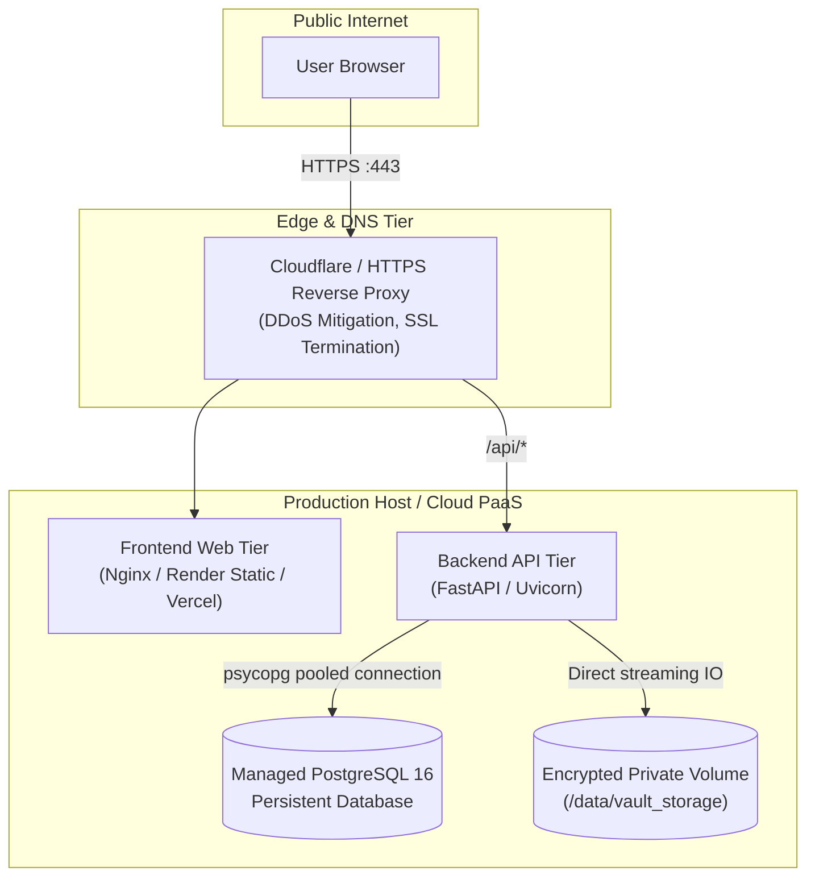

# TrustVault Production Deployment Guide

This guide provides step-by-step instructions for deploying TrustVault to production across multiple target platforms.

---

## Deployment Architecture Overview



---

## Option 1: Render.com Blueprint (Turnkey 1-Click Deployment)

TrustVault includes a pre-configured Infrastructure-as-Code blueprint file: [`render.yaml`](render.yaml).

### Step-by-Step Deployment on Render

1. **Log in to Render:** Go to [dashboard.render.com](https://dashboard.render.com/) and connect your GitHub account.
2. **Create New Blueprint:**
   - In the Render dashboard, click **New +** and select **Blueprint**.
   - Select your repository: `Narendra-1715/Trust_Vault`.
3. **Review Provisioned Resources:**
   Render will automatically detect `render.yaml` and configure:
   - **Database:** Managed PostgreSQL instance (`trustvault-postgres`).
   - **Backend Web Service:** `trustvault-api` (Python 3.12, running Alembic migrations + seeder + FastAPI on port `$PORT`), with a 10GB persistent storage disk for uploaded files.
   - **Frontend Static Site:** `trustvault-ui` (Vite / React 19 build, automatically connected to `trustvault-api`).
4. **Click Apply:**
   Render will provision the database, build the backend container, execute migrations, compile the frontend, and provide public live URLs (e.g., `https://trustvault-ui.onrender.com`).

---

## Option 2: Self-Hosted Cloud VM / VPS (AWS EC2, DigitalOcean, Linode, Hetzner)

For dedicated virtual private servers running Ubuntu 22.04 LTS or Debian:

### Prerequisites

- A Linux server with root or sudo privileges
- Docker and Docker Compose installed:
  ```bash
  sudo apt-get update
  sudo apt-get install -y docker.io docker-compose-plugin
  sudo systemctl enable --now docker
  ```

### Step 1: Clone Repository
```bash
git clone https://github.com/Narendra-1715/Trust_Vault.git
cd Trust_Vault
```

### Step 2: Automated Deployment Script
Execute the provided automated deployment script:
```bash
chmod +x scripts/deploy.sh
./scripts/deploy.sh
```

The script will:
1. Verify Docker installation.
2. Generate a secure `.env` file with cryptographically random `SECRET_KEY` and `POSTGRES_PASSWORD`.
3. Build and launch `trustvault_prod_db`, `trustvault_prod_backend`, and `trustvault_prod_frontend` in detached mode.
4. Execute database migrations and seed demonstration fixtures.
5. Probe the health check endpoint.

### Step 3: Domain & Automated HTTPS (Certbot / Nginx)
To configure SSL/TLS certificates with Let's Encrypt for your custom domain:

```bash
sudo apt-get install -y certbot python3-certbot-nginx
sudo certbot --nginx -d yourdomain.com
```

---

## Option 3: Split Cloud Deployment (Vercel + Railway / Render)

You can host the React frontend on Vercel/Netlify for low latency while hosting the FastAPI backend and PostgreSQL on Railway or Render.

### 1. Deploy Backend (Railway or Render)
- Connect GitHub repo `Narendra-1715/Trust_Vault` to Railway or Render.
- Set root directory to `backend`.
- Add environment variables:
  - `DATABASE_URL`: Your production PostgreSQL connection string.
  - `SECRET_KEY`: Random 64-char hex string.
  - `GEMINI_API_KEY`: Your Gemini API key.
  - `BACKEND_CORS_ORIGINS`: `https://your-frontend.vercel.app` (your frontend domain).
- Note your live API URL: `https://your-api.up.railway.app`.

### 2. Deploy Frontend (Vercel)
- In Vercel, click **Add New > Project** and select `Narendra-1715/Trust_Vault`.
- Set **Root Directory** to `frontend`.
- Set **Framework Preset** to `Vite`.
- Add an Environment Variable:
  - `VITE_API_URL` = `https://your-api.up.railway.app` (your backend URL without trailing slash).
- Click **Deploy**.

---

## Production Security Hardening Checklist

Before moving to public production:

- [ ] **Rotate Secret Keys:** Generate a unique 64-character secret using `python -c "import secrets; print(secrets.token_hex(32))"` and set it as `SECRET_KEY`.
- [ ] **Change Demo Passwords:** Ensure demo accounts (`AdminPass123!`, `OwnerAPass123!`, etc.) have their passwords changed or are deleted from production databases.
- [ ] **Enforce HTTPS / TLS 1.3:** Set up valid SSL/TLS certificates and enable `Strict-Transport-Security: max-age=31536000; includeSubDomains`.
- [ ] **Configure Automated Database Backups:** Schedule daily `pg_dump` backups pushed to an external encrypted storage bucket.
- [ ] **Configure Storage Backups:** Back up `/var/data/vault_storage` using object-storage sync (e.g., AWS S3 bucket sync or Rclone).
- [ ] **Off-Site Audit Anchoring:** For high-assurance compliance, configure periodic signed exports of `audit_events` to an external write-once object lock destination.
