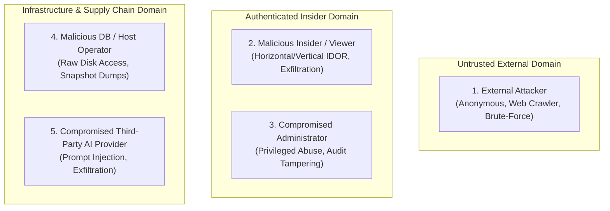
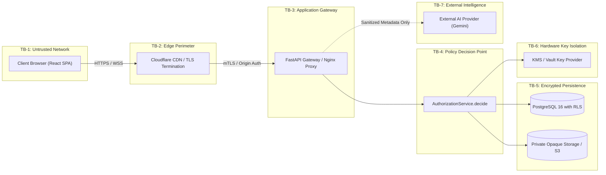

# TrustVault Comprehensive Threat Model (STRIDE)

> **Document Status:** Active Security Architecture Reference  
> **Methodology:** STRIDE (Spoofing, Tampering, Repudiation, Information Disclosure, Denial of Service, Elevation of Privilege)  
> **System:** TrustVault Confidential Document Management Platform  
> **Target Invariants:** I1 (Admin Blindness), I2 (Instant Revocation), I3 (No Existence Leaks), I4 (Private Opaque Storage), I5 (Tamper-Evident Ledger), I6 (AI Zero-Write Boundary)

---

## 1. System Assets & Value Classification

| Asset ID | Asset Description | Security Objective | Criticality |
| :--- | :--- | :--- | :--- |
| **A-1** | **Document Plaintext & Binaries** | Confidentiality, Integrity | **CRITICAL** |
| **A-2** | **Document Encryption Keys (DEKs, KEKs)** | Confidentiality, Availability | **CRITICAL** |
| **A-3** | **Cryptographic Audit Ledger Stream** | Integrity, Non-Repudiation | **CRITICAL** |
| **A-4** | **Active User Session & Refresh Tokens** | Confidentiality, Authenticity | **HIGH** |
| **A-5** | **Document Access Permissions & Policies**| Integrity, Availability | **HIGH** |
| **A-6** | **User Identities, Credentials & PII** | Confidentiality, Integrity | **HIGH** |
| **A-7** | **System Configuration & Security Thresholds** | Integrity, Availability | **MEDIUM** |

---

## 2. Threat Actors & Capabilities

### 2.1 Threat Actor Personas

| Actor | Profile & Motivation | Initial Capabilities | Targeted Assets |
| :--- | :--- | :--- | :--- |
| **1. External Attacker** | Opportunistic or targeted external cybercriminal; seeks data theft or disruption. | Unauthenticated HTTP traffic, automated vulnerability scanners, brute-force engines. | A-1, A-4, A-6 |
| **2. Malicious Insider (User)** | Legitimate employee or contractor with viewer/owner credentials; seeks unauthorized horizontal/vertical access. | Valid JWT, access to UI and authenticated API, ability to upload and share files. | A-1, A-5, A-6 |
| **3. Compromised Administrator** | Rogue or phishing-compromised security administrator; seeks to abuse platform privileges to read confidential executive files. | Valid admin JWT, administrative dashboard access, break-glass invocation capabilities. | A-1, A-2, A-3, A-7 |
| **4. Database / Infra Operator** | Cloud hosting or database administrator with direct server access; seeks offline extraction. | Direct SSH/shell access to host, PostgreSQL root superuser access, filesystem volume snapshots. | A-1, A-2, A-3, A-6 |
| **5. Compromised AI Provider** | Rogue or compromised external LLM service (or prompt injection in metadata); seeks privilege escalation. | Upstream API responses, metadata inspection. | A-5, A-1 |

---

## 3. Trust Boundaries & Architecture

### Trust Boundary Definitions:
- **TB-1 (Client / Edge):** Untrusted public internet. Client browsers, mobile devices, and potential MitM actors.
- **TB-2 (Edge / Gateway):** Edge reverse proxy terminating TLS, filtering DDoS, and applying WAF rules.
- **TB-3 (Gateway / Core API):** Trusted application process running within isolated container execution space.
- **TB-4 (Application / Policy Decision Point):** Central authorization engine enforcing row-level decisions and invariant checks.
- **TB-5 (Core API / Data Persistence):** PostgreSQL database with Row-Level Security (RLS) and private chunked filesystem storage.
- **TB-6 (Core API / Key Management):** Cryptographic root-of-trust (AWS KMS / GCP KMS / Vault) holding the Key-Encryption-Key (KEK).
- **TB-7 (Core API / Third-Party AI):** External untrusted LLM environment.

---

## 4. STRIDE Threat Analysis

### 4.1 Spoofing (Identity Threats)
| Threat ID | Scenario | Impact | Existing / Planned Countermeasure |
| :--- | :--- | :--- | :--- |
| **T-S1** | Attacker brute-forces user credentials to impersonate legitimate owner. | Account takeover, unauthorized document access. | Argon2id hashing with memory-hard parameters; progressive IP and account lockouts; breached password check (HIBP); mandatory MFA for admins. |
| **T-S2** | Attacker steals or replays refresh token to forge valid sessions. | Persistent session hijacking. | Server-side session tracking with `session_version`; refresh token family rotation with automated reuse detection and immediate invalidation. |
| **T-S3** | Attacker spoofs `X-Forwarded-For` or `CF-Connecting-IP` headers to bypass rate limits or forge forensic watermarks. | Attribution evasion, log tampering. | Reverse proxy middleware configured to trust origin IP headers **only** from verified Cloudflare IP blocks with authenticated origin pull (mTLS). |

### 4.2 Tampering (Data Integrity Threats)
| Threat ID | Scenario | Impact | Existing / Planned Countermeasure |
| :--- | :--- | :--- | :--- |
| **T-T1** | Attacker or rogue admin tampers with audit log records in PostgreSQL to conceal exfiltration. | Loss of non-repudiation, compliance failure. | Deterministic SHA-256 hash chaining; database triggers prohibiting UPDATE/DELETE on audit tables; external signed checkpoints anchored in WORM storage (S3 Object Lock). |
| **T-T2** | Attacker swaps, truncates, or reorders encrypted ciphertext chunks in storage. | Plaintext corruption, selective payload injection. | AES-256-GCM chunked envelope encryption with Additional Authenticated Data (AAD) binding `(doc_id, version_id, chunk_index, is_final)`. GCM tag validation per chunk. |
| **T-T3** | Malicious user uploads polyglot or disguised executable file (e.g. executable disguised as PDF). | Remote code execution on server or client. | Magic-byte signature verification, ClamAV antivirus scanning in quarantine buffer, strict MIME/extension allowlist. |

### 4.3 Repudiation (Accountability Threats)
| Threat ID | Scenario | Impact | Existing / Planned Countermeasure |
| :--- | :--- | :--- | :--- |
| **T-R1** | Document owner denies granting access to an insider following an incident. | Dispute over unauthorized sharing. | Every grant/revocation event is committed to the SHA-256 chained audit ledger with actor pseudonym, timestamp, and request ID. |
| **T-R2** | Administrator claims emergency break-glass was never executed. | Unaccountable administrative access. | Two-person approval rule for break-glass; mandatory password + MFA step-up re-authentication; immediate owner notification; automated audit block creation. |

### 4.4 Information Disclosure (Confidentiality Threats)
| Threat ID | Scenario | Impact | Existing / Planned Countermeasure |
| :--- | :--- | :--- | :--- |
| **T-I1** | Malicious insider probes `/api/v1/documents/{id}` with random UUIDs to discover confidential files via differential responses (`403` vs `404`). | Resource enumeration, confirmation of M&A/secret existence. | **Invariant I3:** All unauthorized, nonexistent, expired, or malformed requests return an **identical 404 response** with latency padding to eliminate timing oracles. |
| **T-I2** | System administrator reads confidential document contents or titles without authorization. | Breach of executive confidentiality. | **Invariant I1 (Admin Blindness):** Admins cannot decrypt DEKs without owner grant or break-glass; document titles/filenames encrypted at rest; admins see only minimal operational metadata (UUID, size bucket). |
| **T-I3** | Authorized user takes screenshot or photograph of confidential document preview. | Offline data exfiltration. | Dynamic forensic watermark burned directly into server-rendered preview image pixels (viewer email + IP + timestamp + session ID). |
| **T-I4** | External AI provider ingests sensitive proprietary text during recommendation generation. | Intellectual property leakage to third-party model. | **Invariant I6:** Raw document content is never sent to AI; only sanitized metadata (title, category) is sent; RESTRICTED documents use local rule fallback. |

### 4.5 Denial of Service (Availability Threats)
| Threat ID | Scenario | Impact | Existing / Planned Countermeasure |
| :--- | :--- | :--- | :--- |
| **T-D1** | Attacker floods upload endpoint with 25MB streams to exhaust disk storage. | Storage exhaustion, server crash. | IP sliding-window rate limiters; per-user storage quotas; stream termination when size cap is exceeded; uncompleted uploads purged immediately. |
| **T-D2** | Attacker repeatedly requests expensive cryptographic audit verification to tie up CPU. | API starvation for legitimate users. | Audit verification restricted to authorized roles, rate limited per hour, with asynchronous background execution and cached verification results. |
| **T-D3** | Attacker submits zip/archive bombs or decompression bombs (decompression explosion). | Memory exhaustion (OOM kill). | Decompression ratio caps, entry count limits, and Pillow `MAX_IMAGE_PIXELS` safety bounds. |

### 4.6 Elevation of Privilege (Authorization Threats)
| Threat ID | Scenario | Impact | Existing / Planned Countermeasure |
| :--- | :--- | :--- | :--- |
| **T-E1** | Read-only user attempts to edit document or grant access to colleagues. | Unauthorized permission modification. | Central PDP enforces strict separation: READ != EDIT != SHARE; only owners may grant; no delegation chains. |
| **T-E2** | Revoked user continues streaming remaining chunks of a large file download. | Unauthorized retention of data after access termination. | **Invariant I2:** In-stream re-authorization check every 2 seconds / N chunks against live database `permission_epoch`. Stream cut off mid-flight upon revocation. |
| **T-E3** | AI prompt injection induces system to grant admin privileges or auto-apply permissions. | Autonomous privilege escalation. | AI output strictly constrained to deterministic Pydantic JSON schema; suggestions are written to a quarantined table; grants require explicit human owner approval. |

---

## 5. Security Invariants Traceability Matrix

| Invariant | Description | Primary Threats Mitigated | Verification Mechanism |
| :--- | :--- | :--- | :--- |
| **I1: Admin Blindness** | No role can read or decrypt content without owner grant or two-person break-glass. | T-I2, T-E1 | Automated KMS policy test; admin content stream deny tests; encrypted title column verification. |
| **I2: Instant Revocation** | Permissions verified synchronously on every request and mid-flight during streaming. | T-E2, T-R1 | Automated mid-stream revocation test cutting off download within 2 seconds. |
| **I3: No Existence Leaks** | Uniform 404 response for all unauthorized, malformed, nonexistent, or expired requests. | T-I1, T-D1 | Automated 404 Oracle crawler comparing body, status, headers, and timing variance. |
| **I4: Private Opaque Storage** | Files outside web root, randomized UUID keys, chunked AES-256-GCM envelope encryption. | T-T2, T-T3 | File storage inspection tests; ciphertext chunk tampering tests; purged DEK unrecoverability test. |
| **I5: Tamper-Evident Ledger** | SHA-256 canonical hash chaining with signed external checkpoints in WORM storage. | T-T1, T-R1, T-R2 | Ledger verification suite asserting detection of single-bit flips, deleted rows, and truncation. |
| **I6: AI Zero-Write Boundary** | Advisory only; zero database write permissions; sanitized metadata only; human owner approval. | T-I4, T-E3 | Database role permission tests (`ai_readonly` role); prompt injection regression tests. |

---

## 6. Assumptions & Explicit Out-of-Scope / Residual Risks

### 6.1 Foundational Security Assumptions
1. **Host & Container Isolation:** The operating system kernel and container runtime properly enforce process isolation and memory protection.
2. **Key Management Service (KMS):** The hardware security module (AWS KMS / GCP KMS / Vault) securely manages the Key Encryption Key (KEK) and enforces IAM access policies.
3. **Database Engine ACID Integrity:** PostgreSQL correctly enforces transaction serialization and advisory locks.

### 6.2 Explicit Out-of-Scope & Accepted Residual Risks
1. **In-Flight Network Packets:** Network packets that have already been transmitted over TCP before revocation cannot be recalled or erased from the recipient's machine. Instant revocation guarantees that all subsequent byte streams or refresh attempts are blocked immediately.
2. **Edge Proxy TLS Termination:** Cloudflare terminates external TLS connections and inspects traffic in transit. If Cloudflare's infrastructure were fully compromised, traffic could be observed before reaching TrustVault's origin server. (Mitigated by Origin mTLS and end-to-end envelope encryption).
3. **Compromised User Endpoint:** If a legitimate user's physical computer is infected with kernel-level malware, keyloggers, or screen-recording software, the client device may leak displayed content. TrustVault mitigates this via dynamic forensic watermarking and strict session timeouts, but cannot prevent hardware-level screen captures.
4. **Physical RAM Extraction:** While documents and DEKs are held in server volatile memory during active streaming, a memory dump by a hypervisor administrator with physical access could theoretically expose transient keys.
